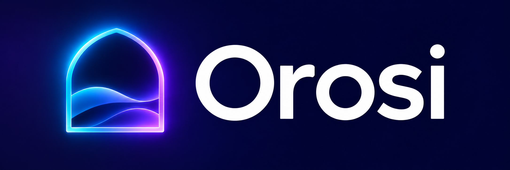

> **English** | [中文](translations/zh-CN/README.md) | [Français](translations/fr-FR/README.md) | [Español](translations/es-ES/README.md) | [日本語](translations/ja-JP/README.md) | [العربية](translations/ar-MA/README.md)

<p align="center">
  
</p>

> [!IMPORTANT]
> Orosi is in active development. The builds on the [Releases](https://github.com/LiberNT/LiberNT/releases) page are Debug pre-releases for testing: run them in a virtual machine or on spare hardware, not on a computer you depend on.

<div align="center">

# [Orosi](https://libernt.com)
### A free NT operating system

**Built out of love for the NT architecture. Windows® 11 compatible, for amd64, arm64 and riscv64.**

[](https://github.com/LiberNT/LiberNT/actions/workflows/build.yml)
[](#license)
[](https://discord.gg/BpcKg7FZ2)
[](https://matrix.to/#/#libernt:matrix.org)


<br>

[](https://github.com/LiberNT/LiberNT/releases)

</div>

## Sponsors

<p align="center">
  <a href="https://github.com/sponsors/ahmedarif193">
    
  </a>
</p>

---

<p align="center">
   

</p>

<p align="center"><sub>The Orosi desktop on amd64</sub></p>

---

### An independent NT operating system by Leeway Open Software

**Windows Compatibility · Independent Engineering · Hardware Longevity**

**Orosi** is an independent operating system project developed and maintained by **Leeway Open Software**, built upon the open-source foundations of **LiberNT** and its underlying ReactOS heritage.

Our goal is to develop a modern, reliable and maintainable implementation of the Windows NT architecture, with **Windows 11 as our principal compatibility reference**.

Orosi is intended to become a practical operating system: capable of running real applications, supporting real hardware and extending the useful lifetime of existing computers, while remaining open to modern computing environments.

The project follows its own engineering direction, integration policies and development priorities.

> [!IMPORTANT]
> **Orosi is under active experimental development.** Current builds are intended for research, testing and validation. Do not use them for critical workloads or store irreplaceable data without independent backups.

---

## What Is Orosi?

Orosi is an independently developed, NT-compatible operating system based on LiberNT.

The NT architecture provides the foundation for modern Windows operating systems, including their kernel, system services, driver infrastructure, security model and application interfaces.

Orosi works toward compatibility with this architecture through open-source development, independent implementations and practical testing.

Our objective is not simply to reproduce the appearance of Windows, but to implement the underlying functionality necessary for a usable, reliable and compatible operating system.

**Orosi is not Microsoft Windows, nor is it a distribution of Microsoft Windows.**

Compatibility with Windows 11 is a development objective, not a claim of complete compatibility.

## Our Vision

We believe useful computing hardware should not become obsolete solely because its original operating system is no longer supported.

Many existing computers can continue performing meaningful work after maintenance, storage upgrades, memory expansion or other reasonable improvements.

Orosi aims to support this possibility without limiting itself to older hardware.

Our development priorities include:

- **Windows compatibility:** NT APIs, Win32 applications, system services and compatible drivers.
- **Hardware longevity:** Extending the practical lifetime of capable Intel and AMD systems.
- **Modern infrastructure:** Networking, storage, graphics, security and system management.
- **Reliability:** Filesystem integrity, recovery, predictable behavior and long-term maintainability.
- **Independent engineering:** Research and implementation under Leeway Open Software's own technical direction.
- **Practical usability:** Moving beyond demonstrations toward real computing environments.

Our long-term interests include desktop computing, refurbished systems, professional environments and potential server-oriented configurations.

These directions do not imply that corresponding product editions are currently available.

---

## Development Philosophy

Orosi follows a practical, evidence-driven approach to operating system engineering.

**Real hardware matters.** Virtual machines provide controlled testing environments, but physical hardware validation remains essential.

**Working implementations matter.** Successful compilation and passing tests are important, but they must be supported by observable functional behavior.

**Compatibility matters.** Publicly documented interfaces and independently observed Windows behavior provide references for implementation and validation.

**Stability matters.** A system that boots successfully is not necessarily ready to protect user data.

**Engineering independence matters.** Orosi may integrate, modify, replace or independently develop components according to its technical objectives and applicable licenses.

We value measurable progress, reproducible testing and functional results over unsupported claims of completeness.

## Architecture and Supported Platforms

Orosi currently prioritizes **AMD64 (x86-64)**, targeting compatible Intel and AMD processors.

This focus allows us to concentrate engineering resources on a defined hardware ecosystem and pursue compatibility and reliability without unnecessarily expanding the supported architecture matrix.

Additional x86 configurations, including selected 32-bit systems, may be evaluated separately.

Orosi does not automatically adopt every architecture or hardware objective supported by LiberNT upstream.

### Platform Direction

| Platform | Direction |
|---|---|
| AMD64 / x86-64 | Primary development target |
| Intel and AMD processors | Primary hardware ecosystem |
| Legacy x86 / i386 | Potential secondary target, subject to validation |
| ARM64, RISC-V, PowerPC | Not current Orosi development priorities |

This table describes project priorities, not a certification of hardware support or a list of available release images.

---

## What Orosi Is Developing

Orosi inherits substantial NT infrastructure from LiberNT and ReactOS while introducing its own research, subsystem changes and independent implementations.

| Area | Development focus |
|---|---|
| **NT kernel and executive** | Compatibility, reliability and subsystem integration |
| **Win32 and NT APIs** | Modern application compatibility and behavioral correctness |
| **Hardware and drivers** | Plug and Play, driver infrastructure and real-device testing |
| **Networking** | TCP/IP modernization, NSI, WSK, NDIS and network filtering |
| **Storage** | NTFS integrity, volume management and recovery |
| **Graphics** | Window management, desktop composition and visual styles |
| **Security** | Access control, integrity levels, elevation and isolation |
| **System administration** | Services, management tools and diagnostics |
| **Installation and servicing** | Setup, updates, maintenance and recovery |
| **Desktop experience** | Explorer, shell integration and user-interface consistency |

The project also investigates modern Windows driver interfaces, system compatibility contracts and supporting infrastructure.

**These are engineering areas, not a declaration that every listed feature is complete, enabled or production-ready.**

## Boot, Installation and Hardware

Orosi retains portions of the inherited LiberNT/ReactOS boot, installation and hardware infrastructure.

Development and testing encompass areas such as:

- BIOS and UEFI boot paths.
- PCI and PCI Express hardware.
- Plug and Play device enumeration.
- USB and storage controllers.
- NTFS installation and volume handling.
- Windows-compatible driver infrastructure.
- Physical hardware and virtual-machine validation.

Actual device compatibility depends on the current build, available drivers and subsystem maturity.

### Installation Safety

> [!CAUTION]
> Experimental operating system builds can overwrite partitions, damage filesystems or behave unpredictably. Use disposable virtual machines or dedicated test hardware, verify the installation target and maintain independent backups.

See [INSTALL.md](INSTALL.md) for installation documentation.

---

## Getting Started

Orosi is currently a development-oriented project. Availability of public installation images and their supported configurations may change.

### 1. Obtain a Build

Consult the repository's releases, build artifacts or development documentation for available Orosi images.

Do not assume that images published by LiberNT upstream contain Orosi's modifications.

### 2. Boot the System

Depending on the available image format and build configuration, testing may be performed using:

- QEMU or another compatible virtual machine.
- Dedicated physical x86-64 hardware.
- A supported preinstalled disk image or installation medium.

Some inherited build targets support raw disk images, VHD/VHDX images and bootable ISO media.

Their availability and behavior must be verified for the selected Orosi revision.

### 3. Install and Test

Follow the installation instructions associated with the selected build.

Installation procedures and compatibility may differ from those of upstream LiberNT.

**Do not install experimental builds over an existing operating system or valuable data.**

---

## Building Orosi

Orosi retains substantial portions of the LiberNT/ReactOS build infrastructure, including CMake-based configuration, cross-compilation tooling and Ninja build targets.

The exact toolchain, configuration options and output targets depend on the current development revision.

### Build Requirements

The inherited build environment uses tools including:

- Git
- CMake
- Ninja
- C/C++ compilation toolchains
- Flex and Bison
- RosBE and associated cross-compilation tools

Supported build hosts and compiler configurations should be verified against the current repository.

### Obtaining the Source

The current development repository is:

[Leeway Open Software — LiberNT-LDW](https://github.com/LeewayOpenSoftware/LiberNT-LDW)

```sh
git clone https://github.com/LeewayOpenSoftware/LiberNT-LDW.git
cd LiberNT-LDW
```

Select the appropriate development branch before configuring or building.

### Configuring a Build

The inherited build infrastructure provides configuration scripts such as:

```sh
./configure.sh
```

The upstream AMD64 Debug configuration uses Clang and generates an output directory following the pattern:

```text
output-Clang-amd64-debug
```

Other configuration options may include:

| Option | Purpose |
|---|---|
| `-a amd64` | Select AMD64 |
| `--clang` | Select Clang |
| `--gcc` | Select GCC where supported |
| `--release` | Request an optimized build |
| `menuconfig` | Open the configuration interface |
| `--no-feeds-update` | Skip updating external sources |

These are inherited build-interface examples. Their continued support and behavior must be checked against the current Orosi revision.

### Building Images

The inherited build system includes targets such as:

```sh
ninja bootcd
ninja liberntimg
ninja liberntvhd
```

These names may remain unchanged internally for compatibility with the existing build infrastructure.

**Internal build target names do not determine Orosi's product identity.**

Output filenames, supported image formats and distribution naming may evolve as Orosi's build infrastructure develops.

---

## Source Tree

Orosi inherits the general source-tree organization of LiberNT and ReactOS.

```text
base/          Applications, services, setup and shell
boot/          Boot components and boot data
bootloader/    Boot management and loading infrastructure
dll/           User-mode libraries and NT/Win32 interfaces
drivers/       Kernel-mode drivers and device infrastructure
hal/           Hardware abstraction
media/         Fonts, themes, sounds and visual assets
modules/       Optional components, applications and tests
ntoskrnl/      NT kernel and executive
sdk/           Headers, libraries and build tools
submodules/    External component integration
subsystems/    Windows subsystem infrastructure
win32ss/       USER, GDI, win32k and graphics components
```

The actual repository may contain additional Orosi-specific directories, integrations and development tools.

Source-tree names inherited from upstream are not necessarily user-facing product names.

---

## Development and Research

Orosi is developed through independent engineering, source-level implementation, automated testing, physical hardware laboratories and AI-assisted workflows.

Leeway Open Software uses engineering agents and AI tools to assist with research, implementation, debugging, documentation and validation.

AI is part of our development process, but it does not replace technical responsibility.

An implementation is not considered correct merely because it compiles or because an AI system reports success.

We evaluate changes through appropriate testing, integration checks, runtime behavior and, where relevant, comparisons with publicly observable Windows behavior.

### Independent Implementation Policy

**Leeway Open Software does not use proprietary Microsoft Windows source code to develop Orosi.**

We do not possess or seek access to Microsoft's confidential Windows source code, and we do not accept contributions based on leaked, confidential or otherwise unauthorized Microsoft source materials.

Our compatibility work uses legitimate technical references, including:

- Publicly available Microsoft documentation.
- Public SDK and WDK interfaces and headers, under their applicable terms.
- Publicly documented NT and Win32 behavior.
- Independently conducted behavioral tests.
- Appropriately licensed open-source implementations.
- Original engineering work, including AI-assisted implementations.

When recreating equivalent Windows functionality, our objective is to develop independent implementations rather than reproduce Microsoft's proprietary source code.

AI-assisted code remains subject to provenance review, technical validation and applicable licensing requirements.

We do not accept the use of AI to conceal copied proprietary code or misrepresent its origin.

**Functional compatibility through independent engineering is our objective.**

---

## Relationship with LiberNT and ReactOS

**Orosi is based on LiberNT, which itself builds upon the ReactOS codebase and development heritage.**

We recognize and appreciate the work of the ReactOS community, the LiberNT contributors and the developers of inherited third-party components.

Their work provides a substantial foundation upon which Orosi continues its development.

Leeway Open Software maintains its own development direction, integration priorities, implementations and experimental infrastructure.

Orosi may selectively integrate upstream improvements while maintaining independent changes and research.

**Orosi is not the official LiberNT project and does not represent the official development direction of LiberNT or ReactOS.**

### Upstream Projects
**Upstream:** As of November 17, 2026, this repository is no longer part of the LiberNT fork network and is now listed directly under ReactOS. Development and maintenance continue independently under Leeway Open Software.

**Leeway Development Repository:** https://github.com/LeewayOpenSoftware/LiberNT-LDW

- [LiberNT](https://github.com/LiberNT/LiberNT)
- [ReactOS](https://github.com/reactos/reactos)

### Leeway Development Works

Orosi's development originates in **LiberNT-LDW (Leeway Development Works)**, the Leeway Open Software development repository based on LiberNT.

LDW provides a research and integration environment for compatibility improvements, subsystem development, hardware validation and experimental implementations.

The development history also includes research associated with **Aureline and Asterion**, Leeway's earlier Wine- and ReactOS-related projects.

Repository history, inherited code attribution and applicable licenses are preserved independently of product branding.

See [FORK.md](FORK.md) and [PURPOSE.md](PURPOSE.md) for additional development context.

---

## Contributing

Orosi's development is currently directed and maintained by Leeway Open Software.

Public availability of the source code does not automatically imply that every development branch accepts unsolicited pull requests, feature proposals or external modifications.

Contribution procedures, when available, are documented in [CONTRIBUTING.md](CONTRIBUTING.md).

Any submitted contribution must respect applicable licensing, copyright and source-provenance requirements.

Contributions based on unauthorized proprietary Microsoft Windows source code are not accepted.

---

## Licensing and Attribution

Orosi includes source code inherited from LiberNT, ReactOS and other open-source projects.

Inherited components retain their applicable copyright notices, licenses and attribution requirements.

Leeway Open Software also develops original implementations, documentation, branding, artwork and other project materials.

The applicable rights and permissions depend on the relevant component and its licensing terms.

Original Orosi branding and separately licensed assets are distinct from the inherited software codebase.

**No branding statement overrides the permissions or obligations established by an applicable open-source license.**

Refer to the repository's license files, source headers and attribution documentation for the authoritative terms.

See [CREDITS.md](CREDITS.md) for project acknowledgements and inherited development credits.

---

## Project Identity

**Orosi** is developed by **Leeway Open Software**.

*Independent Computing Research and Development.*

Orosi has its own project identity, engineering direction and development objectives.

Its relationship with LiberNT and ReactOS is acknowledged without implying organizational affiliation or endorsement.

Orosi is not affiliated with, sponsored by or endorsed by Microsoft Corporation.

Windows is a trademark of Microsoft Corporation. Other names and trademarks belong to their respective owners.

---

**Leeway Open Software — Orosi**

*Independent engineering. Practical compatibility. Computing without unnecessary obsolescence.*
